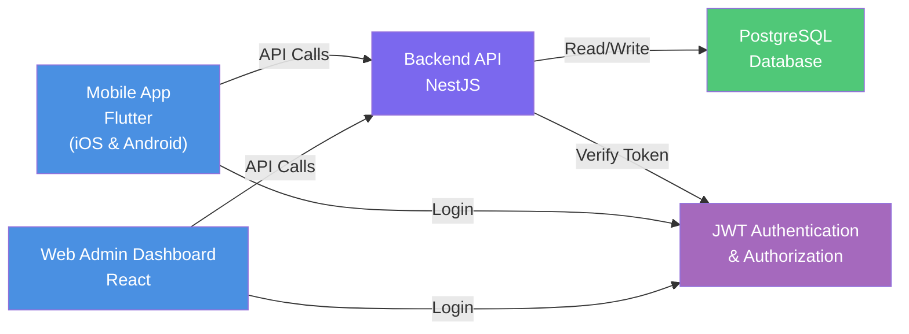

# WorkBridge

## Overview
WorkBridge is a two-sided job marketplace designed to connect job seekers with businesses offering local, flexible employment opportunities, including part-time, temporary, and full-time jobs.

The platform provides a structured alternative to informal hiring channels such as Facebook groups and WhatsApp, making it easier to find jobs, manage applications, and communicate with employers.

## Features

- **Authentication & Authorization:** Secure registration and login with role-based access control.
- **Job Seeker Profiles:** Create profiles showcasing skills, experience, and availability.
- **Job Listings:** Employers can create, edit, and manage job postings.
- **Search & Filtering:** Find relevant jobs based on location, category, skills, salary, and working hours.
- **Job Applications:** Apply for jobs and track application statuses.
- **Applicant Management:** Employers can review applicants and update their application statuses.
- **Admin Dashboard:** Manage users, businesses, job listings, reports, and job categories.

## User Roles

### 1. Job Seeker
- Create and manage a personal profile.
- Search and filter available jobs.
- Apply for jobs and track application progress.

### 2. Employer
- Create and manage a business profile.
- Post, edit, and close job listings.
- Review applicants and manage application statuses.
- Mark positions as filled.

### 3. Admin
- Manage users and business accounts.
- Monitor and remove inappropriate job listings.
- Review and resolve user reports.
- Manage job categories and skills.

## Workflow

1. An employer publishes a job listing.
2. A job seeker searches for suitable opportunities.
3. The job seeker submits an application.
4. The employer reviews the application and updates its status.
5. The employer marks the position as filled when the hiring process is complete.

## Architecture Diagram

---
## Project Goals

- Simplify local and flexible job discovery.
- Improve the organization and transparency of the hiring process.
- Provide structured application tracking for job seekers and employers.
- Demonstrate development through authentication, database management, search, notifications, and administrative tools.

## Project Scope

WorkBridge is developed as a graduation project, focusing on a practical, functional job marketplace with three user roles: Job Seeker, Employer, and Admin.

The initial version (MVP) prioritizes core hiring workflows and essential platform management features, with additional functionality introduced only when time and resources allow.
